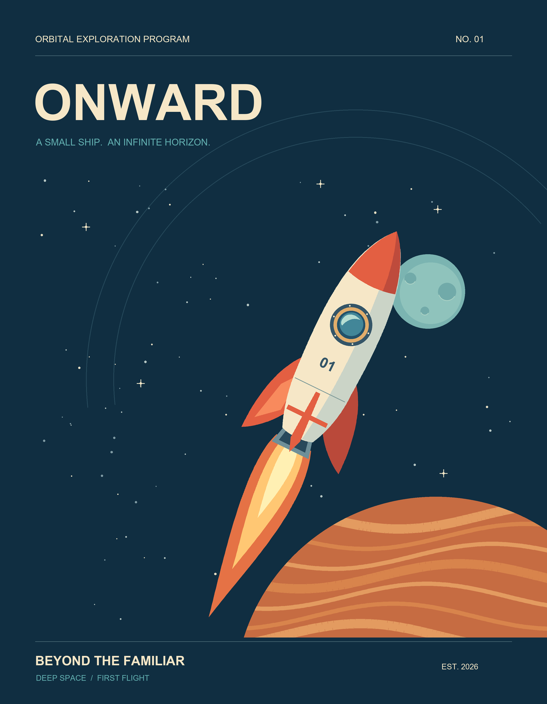
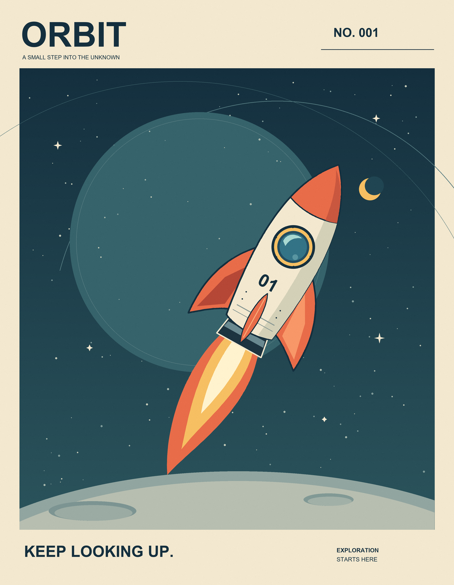
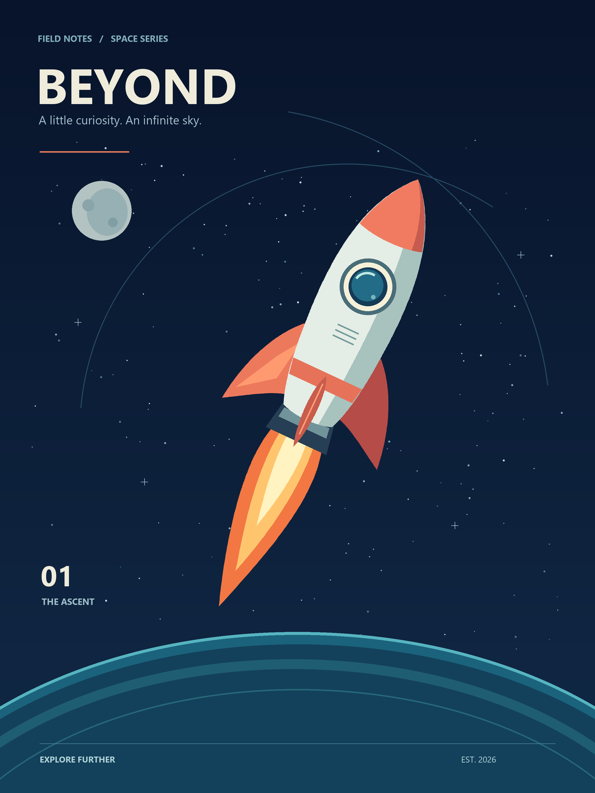

# 로켓 코딩 A/B/C 실제 비교

공통 요청은 정확히 **“로켓을 그리는 코드를 만들고 실행하여 결과 그림을 저장하세요.”**입니다. 그룹별로 그림의 화풍·완성도·복잡도·구성요소를 지정하지 않았습니다. 서로 다른 독립 에이전트가 코드를 만들고 실행했습니다. 이미지 생성 모델로 만든 그림은 포함하지 않습니다.

## 결과 그림

| A · 추가 스킬 없음 | B · 검증 스킬 | C · 제조업 프로세스 스킬 |
|---|---|---|
|  |  |  |
| [코드](A/draw_rocket.py) · [검사](A/verify_output.py) · [기록](A/REPORT.md) | [코드](B/draw_rocket.py) · [검사](B/verify_output.py) · [기록](B/REPORT.md) | [코드](C/draw_rocket.py) · [검사 결과](C/verification.json) · [기록](C/REPORT.md) |

세 결과 모두 로켓 기체·창·날개·불꽃을 코드로 생성했습니다. A는 짙은 청록색 배경과 주황색 행성, B는 종이색 테두리와 질감·달 표면, C는 어두운 배경과 청록색 행성 곡면을 표현했습니다. 이것은 관찰된 디자인 선택이며 스킬의 고유 화풍으로 일반화하지 않습니다.

## 조건과 실제 적용

| 항목 | A | B | C |
|---|---|---|---|
| 제공 스킬 | 없음 | verification-before-completion 1개 | 제조업 프로세스 스킬 16개와 인덱스 |
| 실제 읽고 적용한 스킬(에이전트 기록) | 없음 | verification-before-completion | standard-work 1개 |
| 구현 환경 | Python 3.11.15 / Pillow 11.3.0 | 동일 | 동일 |
| 그림 크기 | 1400×1800 | 1400×1800 | 1200×1600 |
| 렌더 코드 줄 수 | 146 | 153 | 150 |
| 별도 검사 코드 줄 수 | 18 | 22 | 0: 렌더 코드 안에 검사 포함 |
| 검증 방식 | 별도 검사 스크립트 | 별도 검사 스크립트 | 저장 직후 다시 열어 검사하고 JSON 기록 |
| 실제 렌더 종료코드 | 0 | 0 | 0 |
| 조정자 독립 재실행 | 동일 PNG 해시 | 동일 PNG 해시 | 동일 PNG 해시 |
| 생성 그림 크기(bytes) | 265,518 | 762,753 | 213,648 |

줄 수는 주석·공백을 포함한 물리적 줄 수입니다. C의 150줄에는 파일 검증·JSON 기록이 포함되어 있으므로 렌더 코드만의 길이를 공정하게 순위화하는 지표가 아닙니다. 이미지 해상도와 질감이 달라 파일 크기도 효율 우열 지표로 사용하지 않습니다.

## 코드에서 실제 확인되는 차이

**A**는 `draw_poster()`와 도형·폰트 보조 함수를 만들고, `verify_output.py`를 별도로 작성했습니다. `random.Random(41)`을 렌더 함수 안에서 만들며, Arial 폰트를 못 찾으면 기본 폰트로 넘어가는 예외 처리가 있습니다. 추가 스킬이 없어도 실행·파일 검사·시각 확인을 수행했습니다.

**B**는 `main()`과 공통 도형 함수를 사용하고, 별도 `verify_output.py`로 결과를 검사했습니다. 고정 시드 47과 175,000회의 픽셀 질감 처리가 들어 있습니다. 검증 스킬의 방향과 맞게 실제 실행·PNG 검사·시각 확인의 근거를 남겼지만, 이번 과제에서 A보다 강한 검증을 했다고 단정할 차이는 작았습니다. Arial 폰트를 직접 요구하며 대체 폰트 처리는 없습니다.

**C**는 `main()` 안의 지역 도형 함수들을 사용하고, 렌더 후 저장된 PNG를 다시 열어 크기·모드·형식·색상 범위를 검사했습니다. 검사 결과에 SHA-256·파일 크기·시각을 넣은 `verification.json`을 생성합니다. Segoe UI의 Windows 경로를 명시하므로 다른 환경의 폰트 처리는 추가 확인이 필요합니다. 이 구현 방식은 실제 관측된 차이이며, 스킬이 이 구조를 강제한 것은 아닙니다.

세 그룹 모두 2배 크기로 그린 뒤 축소했습니다. 별도 검사 유무보다 중요한 것은 실제 저장 파일을 확인했는지인데, 세 그룹 모두 이를 수행했습니다. 프로그램이 실행되고 PNG가 열리는 것만으로 로켓 모양이 맞다는 사실까지 자동 증명되지는 않습니다. 로켓의 식별 가능성은 세 이미지를 직접 열어 확인했습니다.

## 이번 비교에서 내릴 수 있는 판단

- 세 조건 모두 원 요청인 코드 작성·실행·로켓 그림 저장을 충족했습니다.
- 코드 구성과 그림의 디자인에는 차이가 생겼습니다. 하지만 “A는 대충, B는 정확히, C는 완벽하게” 같은 단계 차이는 관측되지 않았습니다.
- C는 과제에 비례해 `standard-work`만 선택했습니다. 이는 16개를 전부 로드하지 않는 원본 라우팅 원칙과 부합합니다. PFMEA·Poka-Yoke·MSA 등의 효과를 이 결과로 검증했다고 말할 수 없습니다.
- 이 단순 생성 과제에서는 A/B/C의 기본 능력이 모두 충분하여 추가 프로세스의 차이가 크게 드러나지 않았습니다. 각 1회 관찰이므로 스킬 효과와 생성 변동을 분리할 수 없습니다.
- 개선 방향은 C에게 문서를 더 쓰도록 강요하는 것이 아니라, 필요할 때 위험·검증·변경 관리가 실제 실행으로 연결되는지를 확인하는 것입니다.

## 재현과 검증

각 폴더에서 `python draw_rocket.py`를 실행하면 해당 폴더의 `rocket.png`가 다시 생성됩니다. A/B의 별도 검사는 `python verify_output.py`입니다. C의 검사는 렌더 실행 안에 포함됩니다. 설치된 Pillow 버전은 [requirements.txt](requirements.txt)에 기록했습니다. 폰트가 다른 환경에서는 같은 이미지가 보장되지 않습니다.

원본 제출물을 덮어쓰지 않는 비교 재검증은 저장소 루트에서 실행합니다.

```sh
python -X utf8 scripts/recheck_rocket.py
```

이 스크립트는 임시 복사본에서 각 렌더러와 제공된 별도 검사기를 실행하고, PNG 디코딩과 원본 해시 일치를 확인합니다. [재검증 결과](verification/results.json)와 [A](verification/A.log) / [B](verification/B.log) / [C](verification/C.log) 원시 로그가 있습니다.

## 실험 기록과 한계

- 생성 전 입력: [protocol.json](protocol.json), 각 그룹의 동일한 TASK.md·ADMIN.md. 공통 입력의 SHA-256 일치를 재검증했습니다.
- 새 에이전트: `/root/rocket_a`, `/root/rocket_b`, `/root/rocket_c`, 모두 `fork_turns=none`, 모델·추론 설정 override 없음.
- 작업일: 2026-11-02 America/Chicago. 로그 시각은 2026-11-03 UTC입니다.
- 그림 코드의 실패·수정은 세 에이전트 모두 없었다고 기록했습니다. 세 그룹 모두 환경의 F: 드라이브 런처 문제를 겪고 동일하게 허용된 호스트 실행으로 진행했습니다.
- 작업 폴더와 대화 문맥을 분리했지만 공유 파일시스템의 읽기 격리를 OS 수준으로 강제하지는 않았습니다. 전체 도구 트레이스는 이 저장소에 보존되지 않았고, 스킬 읽기 내역은 에이전트 기록입니다.
- A에도 공통 플랫폼 지침과 동일한 실험 기록 요구가 적용됩니다. A는 모든 지시가 없는 모델이 아니라 추가 작업 스킬이 없는 조건입니다.
- 개발 시간의 최초 기록 전에 지침 읽기와 런처 실패가 있어 전체 소요시간을 정확히 비교할 수 없습니다. 동시 실행 자원 경합도 있으므로 시간 순위를 만들지 않았습니다.
- 정확한 내부 모델 revision·토큰·비용은 미계측입니다. 각 그룹 1회이며, 평가 기준을 수치 점수로 사전 등록한 통제 실험이 아닙니다. 원 요청의 실행 결과와 코드 구조를 기술적으로 비교한 파일럿입니다.
