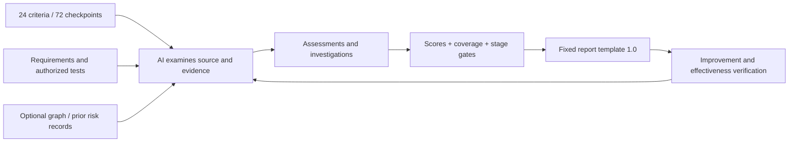

# Software Assurance Auditor

An independent AI software audit tool with built-in questions, evidence scoring, stage gates, failure investigation and corrective-action verification. This is an initial translation of manufacturing audit and quality practices into software assurance.

Ask: Are harmful actions prevented? Can a stage hand its outputs to the next stage with valid evidence? Can a failure be reproduced and its cause distinguished from a hypothesis? Does a correction prevent recurrence without breaking connected behavior?

## Two independent products

| Product | Purpose | Installation |
|---|---|---|
| 16 production-inspired coding skills | Guide specification, development, verification and change | Choose skill folders; no audit package required |
| Software Assurance Auditor | Audit software and its development process against built-in criteria | CLI/MCP package; no skills or Graphify required |

The optional software-process-audit skill guides an agent through the independent tool. The package includes its own criteria; existing risk documents, analyzers, tests and Graphify only enrich evidence.

## Workflow



The AI judges evidence content; the engine validates records, computes scores and renders the fixed report. MCP provides inventory and bounded file reading. Tests run through authorized host tools; this server never executes arbitrary project commands.

## Start

Python 3.11+. CLI uses only the standard library. The optional MCP service uses official SDK 2.3.0.

```sh
python -m pip install .
software-audit criteria
software-audit init --scope "Workflow and exclusions" --revision SNAPSHOT --out review.json
software-audit evidence --repo /project --path tests/results.txt --id E1 --kind execution --revision SNAPSHOT
# Review each checkpoint and fill the manifest with actual evidence.
software-audit next --repo /project --manifest review.json --revision SNAPSHOT
software-audit report --repo /project --manifest review.json --revision SNAPSHOT --out reports/run-001 --strict
```

See [MCP download/setup](MCP_SETUP.md), [complete questionnaire](AUDIT_QUESTIONNAIRE.md), [scoring/model contract](../skills/software-process-audit/references/audit-model.md), and [blank standard report](../examples/software-audit/blank-report.md).

## Scores and stable output

Scores 0-4 describe evidence maturity. Unverified remains unscored. Observed score, weighted coverage and documented achievement lower bound are shown together. High-impact risks block stage transitions independently of averages.

Stable checkpoint IDs, columns and standard/schema/template versions make results comparable. Every checkpoint remains present. Findings, improvements, owner/due fields and verification evidence have fixed positions. JSON and Markdown come from the same evaluated result; AI narrative supplements them.

Without prior process documents, start from source, intended behavior and the questionnaire. Corrective cases follow problem definition  ->  containment  ->  reproduction  ->  root cause  ->  correction  ->  effectiveness. Preventive cases challenge proposed controls before harm.

Graphify contributes optional relationship candidates, preserving direction and extracted/inferred evidence. It does not define scores or replace behavior verification. Existing risk/release records can be evidence. [Integration details](../skills/software-process-audit/references/graphify.md).

## Limits and validation

The `0.3.0a1` public preview adds built-in Python connection mapping, eight connection probes, an offline score summary, interactive risk links and improvement tasks. `report` now writes fixed JSON/Markdown plus `report.html` and `improvement-plan.json`. Graphify and REA are optional imports; neither is required for an audit. See [usage and boundaries](CONNECTION_RISK_REVIEW.md) and [the independently runnable failure/correction example](../examples/connection-audit/README.md).

Initial release; no certification or defect-probability claim. The engine cannot authenticate logs, infer complete coverage or prove live behavior. Weights are an initial policy; semantic judgment and source identity remain reviewer responsibilities.

Tests cover scores/coverage, unknowns, omitted rows, stale evidence, gates, high-risk overrides, investigation completion, graph bounds, deterministic reports and real stdio MCP calls against an installed package. Run `python -m unittest discover -s tests -v`; install `.[mcp]` to include integration testing. Environment-dependent skipped tests stay disclosed.
